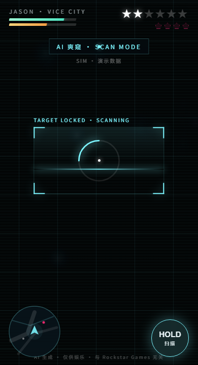
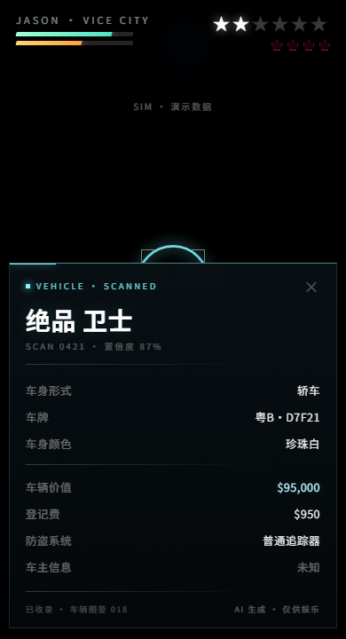

# AI 车扫 · 现实版 GTA 扫描 HUD

> 用手机对着车扫一下，弹出一张「游戏风格」的车辆信息卡。
> 检测、车牌 OCR、映射全在端侧，不联网、不上传。

一个把 GTA 里「AI 爽窥」界面做成现实版的 Android App，外加一套纯前端 HUD 原型。

<p>
  
  
</p>

---

## 它能做什么

| 环节 | 实现 | 状态 |
|---|---|---|
| 相机预览 | CameraX | ✅ |
| 目标检测 | EfficientDet-Lite0（COCO，端侧 TFLite） | ✅ car / truck / bus / motorcycle |
| 车身形式 | 由检测类别映射 | ✅ 4 类 |
| 车牌识别 | ML Kit 中文 OCR + 车牌规则 | ✅ 真车白天约 85% |
| 车身颜色 | 框内采样 + 最近色匹配 | ✅ 8 色 |
| 游戏车名 | 本地映射表查表 | ✅ 55 条车型 + 8 条兜底 |
| 车辆价值 / 登记费 | 映射表数值 | ✅ 按游戏设定 |
| 车主信息 | —— | ❌ 永远显示「未知」 |
| 追踪器状态 | —— | ❌ 永远显示「无法获取」 |

### 能力边界（重要）

- **分不出轿车和 SUV**。COCO 只有一个 `car` 类，所有乘用车都会归为「轿车」。
- 车牌在真车近距离白天约 85% 能识别，翻拍屏幕上的车牌基本识别不了。
- 颜色是 16 点平均色，深色车容易判成「石墨灰」。
- 「防盗系统 / 追踪器 / 车主信息」在现实中不存在公开数据，**这是设计上的固定文案，不是功能缺失**。

---

## 下载安装

到 [Releases](../../releases) 页下载最新的 `AI爽窥-x.y.z.apk`，传到手机安装（需要允许「未知来源」）。

- 最低系统：Android 7.0（API 24）
- 包名：`com.leonidascan.app`
- 首次启动会申请相机权限，模型加载约 1–2 秒

---

## 从源码构建

需要 JDK 17 + Android SDK（platform 34 / build-tools 34.0.0）。

```bash
cd android
# 在 local.properties 里写你自己的 SDK 路径
echo "sdk.dir=/path/to/Android/Sdk" > local.properties

gradle assembleDebug
# 产物：android/app/build/outputs/apk/debug/app-debug.apk
```

首次构建会从 Maven 拉 CameraX、TFLite、ML Kit，约 100 MB。

### 只想看 UI？

根目录的 `index.html` 是纯前端原型，手机浏览器直接打开即可：

- 长按画面任意处 = 扫描
- 支持真实相机（`getUserMedia`），拒绝授权会退到演示背景
- 数据是模拟的，用于评审 UI 和交互节奏

---

## 技术栈

- **UI**：WebView 承载 HUD（HTML/CSS/JS），原生层透明叠加在相机预览上
- **相机**：CameraX `ImageAnalysis`（YUV→ARGB，960×540，150ms 节流）
- **检测**：EfficientDet-Lite0 TFLite，320×320 UINT8 输入，`TFLite_Detection_PostProcess` 输出
- **OCR**：ML Kit `text-recognition-chinese`
- **音效**：numpy 合成，SoundPool 播放
- **数据**：`现实车-游戏车映射表.csv`（校验脚本见 `tools/`）

### 踩过的坑

模型带自定义算子 `TFLite_Detection_PostProcess`，且 4 个输出在 flatbuffer 里声明为**空形状**。两件事一起做才行：

1. 模型必须用**直接缓冲区**加载（`ByteBuffer.allocateDirect`），`ByteBuffer.wrap(byte[])` 会抛异常
2. 输出必须用 `run(input, null)` + `getOutputTensor(i).asReadOnlyBuffer()` 读，传 `Object[]` 会因为类型推断失败抛 `cannot resolve DataType`

细节见 [方案-现实版AI爽窥.md](方案-现实版AI爽窥.md) 附录。

---

## 项目结构

```
├── index.html                  # H5 原型（可直接浏览器打开）
├── shot-*.png                  # 界面截图
├── 现实车-游戏车映射表.csv      # 现实品牌/车身形式 → 游戏车名 + 价值
├── 方案-现实版AI爽窥.md         # 完整方案：可行性、技术选型、合规、踩坑
├── validate_mapping.py         # 映射表校验（9 项检查，可挂 CI）
├── make_sfx.py                 # 音效合成
├── make_icons.py               # 图标生成
└── android/                    # Android 工程
    └── app/src/main/
        ├── assets/             # index.html / mapping.csv / 模型
        ├── java/.../           # MainActivity / Detector / PlateReader / CarDb
        └── res/raw/            # 音效
```

---

## 免责声明

- 本项目是**非官方、非商业的个人项目**，与 Rockstar Games、Take-Two Interactive 无任何关联。
- 游戏内的品牌名与车型名（如「绝品」「奥北」「密探」等）是 Rockstar Games 的虚构商标，本项目仅作致敬与娱乐用途。
- 本项目**不包含**任何游戏素材、模型或美术资源。
- 请勿将本工具用于拍摄、跟踪、识别他人。车牌号结合车辆可识别到自然人，属于个人信息。**代码默认全端侧处理，不上传、不落盘。**
- 扫描结果中的「车辆价值 / 登记费 / 防盗系统」是游戏设定值，**与现实无关**。

## License

代码部分 MIT，见 [LICENSE](LICENSE)。游戏相关的名称与商标归其所有者。
